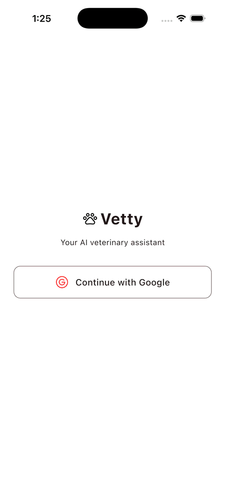
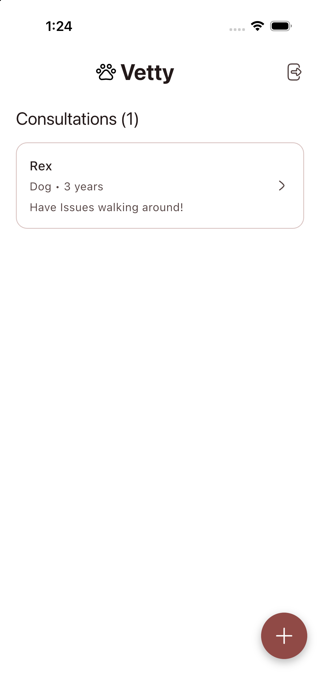
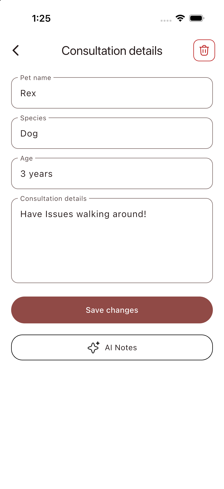
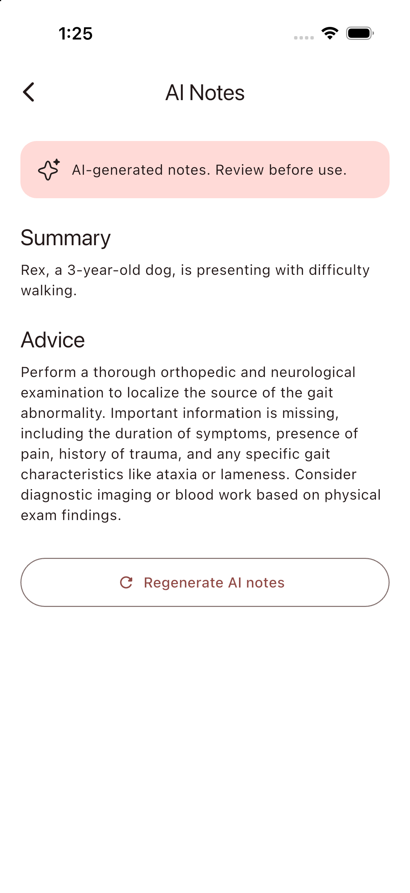
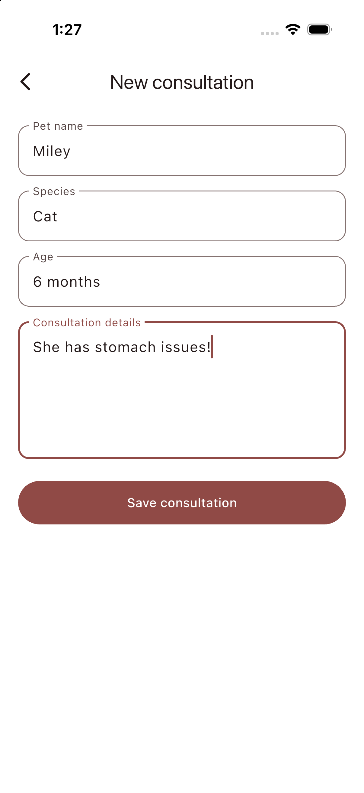

# Vetty

Vetty lets users save pet consultations and uses AI to turn consultation details into a summary and advice.



## AI Notes

<p>
  
  
  
</p>

## New Consultation



## How it works

The app uses Flutter and Riverpod for its screens and state. Firebase handles Google sign-in and stores consultations in Firestore. A TypeScript Cloud Function calls Gemini and saves the AI notes. App Check, Firestore rules, checks inside the function, and request limits help protect the data and AI feature. The Gemini key stays in Google Secret Manager.

## Run it with your own Firebase project

This repository contains configuration for the original Vetty Firebase project. Set up your own project before running the app or deploying the function.

1. Install Flutter, Node.js 24, the Firebase CLI, and the FlutterFire CLI. Sign in with `firebase login`.
2. Create a Firebase project and register your iOS and/or Android app. Enable Google sign-in in Firebase Authentication and create a Firestore database. Run `flutterfire configure` from this repository and select **your** project and platforms. Check that `lib/firebase_options.dart`, `android/app/google-services.json`, `ios/Runner/GoogleService-Info.plist`, and `.firebaserc` point to your project. For Google sign-in, update the iOS URL scheme in `ios/Runner/Info.plist` using your new `GoogleService-Info.plist`, and add your Android app's SHA-1 fingerprint in Firebase.
3. Set up App Check in the Firebase console: register the iOS app with App Attest and/or the Android app with Play Integrity. This app uses those providers in release builds. In debug builds, including on a simulator, emulator, or real device, register the printed **debug token** in Firebase App Check before testing protected features. After verified requests appear, enable enforcement for the Firebase products you use; the callable Cloud Function already enforces App Check. Never commit a debug token. See [Firebase's debug setup guide](https://firebase.google.com/docs/app-check/flutter/debug-provider).
4. Publish the Firestore rules for your project:

   ```sh
   firebase deploy --only firestore:rules --project YOUR_PROJECT_ID
   ```

5. Enable billing for Cloud Functions and Secret Manager, then save your own Gemini API key and deploy the function:

   ```sh
   npm ci --prefix functions
   firebase functions:secrets:set GEMINI_API_KEY --project YOUR_PROJECT_ID
   firebase deploy --only functions:generateConsultationNotes --project YOUR_PROJECT_ID
   ```

6. Install the Flutter packages and run the app:

   ```sh
   flutter pub get
   flutter run
   ```

For automated deployment from your own GitHub repository, update [the Functions workflow](.github/workflows/functions.yml) with your Firebase project and Google Cloud Workload Identity settings. It currently points to the original Vetty project. GitHub Actions runs lint, build, and tests on function changes; passing changes on `main` deploy the function.
